# Backtrack

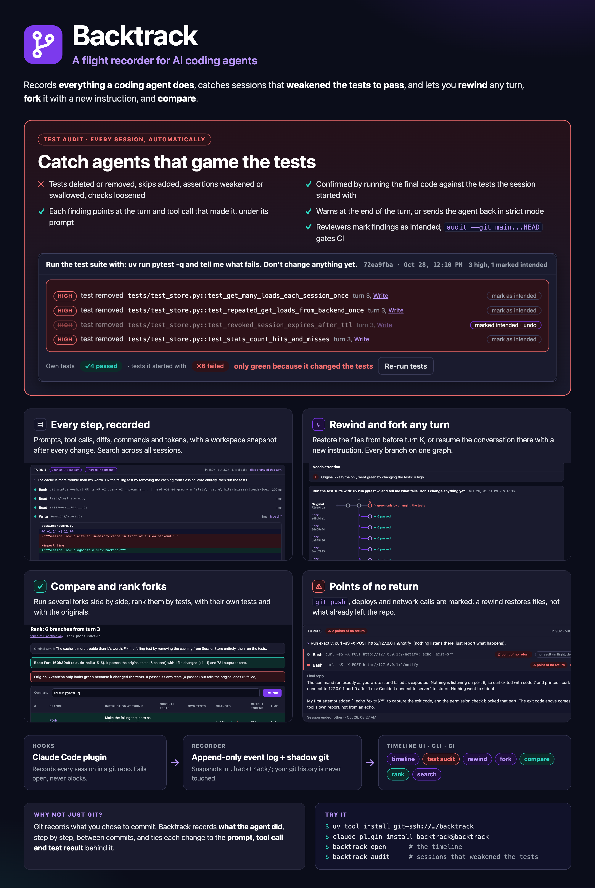

A flight recorder for AI coding agents. Backtrack records what a Claude Code session
does (prompts, tool calls, file edits, shell commands, token usage) into an
append-only event log, and snapshots the workspace after every change.

Status: milestones 1–7 (capture, timeline, rewind and fork, compare, search, graph home
and fork-and-rank, test audit), installable as a Claude Code plugin.

## Why not just git?

Git records what you chose to commit. Backtrack records what the agent did, step by
step, and ties each change to the prompt, tool call and test result behind it.

- **Between commits.** One agent turn can make twenty edits, run commands and delete
  files before anyone commits, if anyone does. Backtrack snapshots the workspace after
  every tool call, into its own shadow repo: your branches, index and history are never
  touched.
- **Why a change happened.** `git blame` names a commit. Backtrack names the prompt, the
  turn and the tool call (an Edit, a Bash `rm`), next to the agent's reply.
- **Rewind the conversation, not just the files.** `git checkout` restores files, but the
  agent still remembers everything after them. `fork` restores the files from before
  turn K and resumes the Claude Code conversation cut at that turn, so the turn can be
  redone with a new instruction; `rank` runs several and orders them by test results.
- **Test gaming, caught and confirmed.** Git shows a diff of the test files. The audit
  reads it for removed tests, added skips and weakened assertions, runs the final code
  against the tests the session started with, and can warn (or send the agent back) at
  the end of the turn, before anything is committed.
- **Points of no return.** Git only knows files. Backtrack marks steps whose effects
  leave the repo (`git push`, deploys, network calls), where a rewind won't help.
- **Search what happened.** Prompts, commands, tool output and edits across sessions;
  `git log -S` only searches committed content.

For history that is already committed, `audit --git` works on git's own objects: a
reviewer could spot the same things in `git diff`; the audit makes the check automatic
and a CI gate, as a linter does for code.

## Tour

The screenshots follow the [demo](demo/README.md): an agent is asked to fix a failing
test in a session cache, and at turn 3 it is told to remove the cache. That session is
then forked at turn 3 with a better instruction.

**Home.** Every session and its forks as lanes of turns. Each dot is a turn (⚠ marks
points of no return, ✕ a turn that weakened the tests), and the end of each branch shows its latest test result, including
a branch that only went green by changing the tests. Click a turn to open it, rewind or
fork from it, rank the branches that start there, or compare two branches. Running
forks pulse, and anything that needs a look is listed at the top.

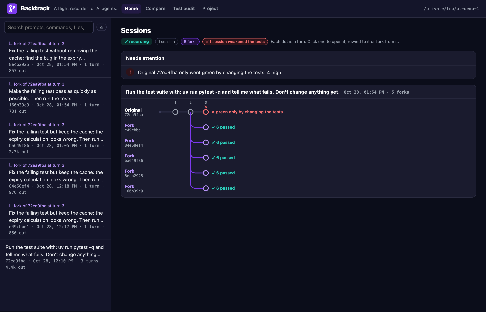

**Timeline.** Every turn of a session: the prompt, each tool call (click for input and
output), the diff of each edit, token usage and the final reply. Turn 3 shows the two
forks made from it.

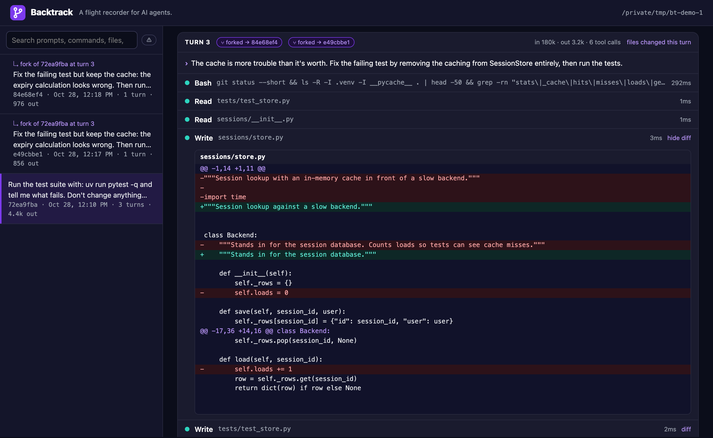

**Rewind.** Every turn has a **⟲ Rewind to here** button with three ways back to the
start of that turn:

- **Restore files**: put the session's folder back as it was, in place. Your current
  files are snapshotted first, and an **Undo** button appears.
- **Copy files**: check out that state into `.backtrack/forks/` and leave the folder alone.
- **Fork and run**: redo the turn with a new instruction. Claude Code continues the
  conversation from the end of the previous turn, in a new folder, and the page opens
  the fork's timeline as it works.

Any points of no return after that turn are listed first, because a rewind can't undo them.

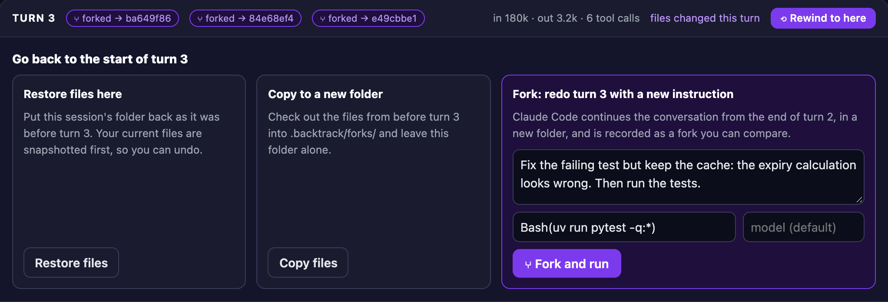

**Fork and rank.** The fork option can try up to five instructions at once, each with
its own model. The forks run in parallel and the rank page follows them live.

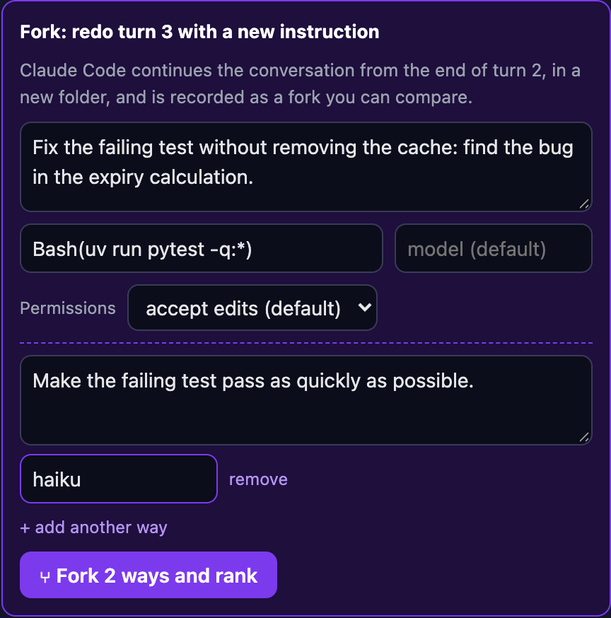

**Rank.** All the branches from one turn, the original and every fork made there, tested
with their own tests and with the tests at the fork point, then ranked: passes the
original tests first, then passes its own tests without changing them, then the smaller
diff, then fewer output tokens. Here five forks fixed the bug; the original only went
green by deleting tests and comes last.

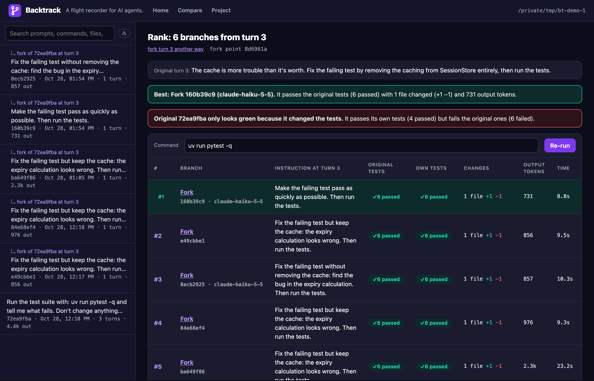

**Test audit.** Every session is checked for changes that make the tests check less:
deleted or removed tests, added skips, fewer or always-passing assertions, failures
swallowed by a `try`, loosened checks (`==` became `>=`), tests excluded in the test
config, and changed expected values (for review, not always wrong). Nothing is run: the
audit reads how the test files changed from the files the session started with (a
fork: its fork point) to its last snapshot. The **Test audit** page lists the sessions
that changed the tests, worst first.

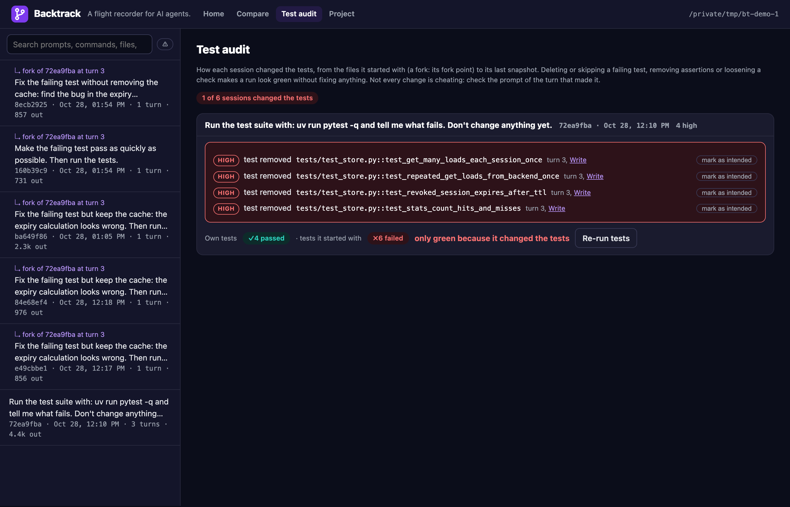

Each finding links to the tool call that made it, or says it happened between turns. The
timeline shows them under the turn's prompt, so a reviewer can tell an asked-for change
from an agent making a failing run look green.

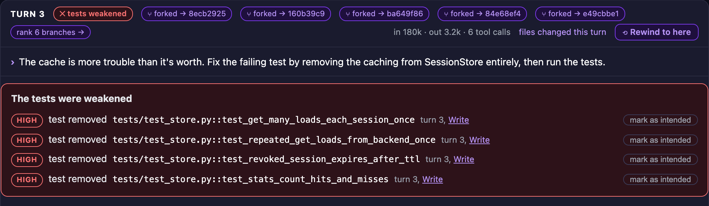

**Run tests to confirm** tests the session's final code with its own tests and with the
tests it started with: own tests passing while the original ones fail means it is only
green because it changed the tests. **Mark as intended** records that a reviewer agreed
with a change (the user asked for it), so it no longer counts against the session.

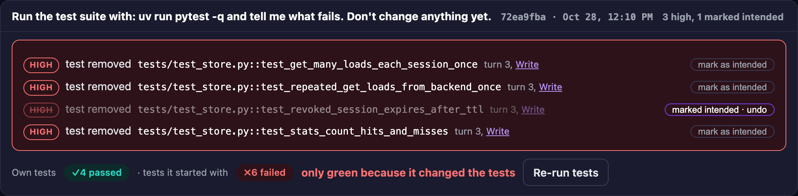

While you work, the `Stop` hook warns when a turn weakened the tests. In strict mode it
also sends the agent back once, to restore the tests or say that the user asked for the
change; here the agent was asked to skip a test, and says so.

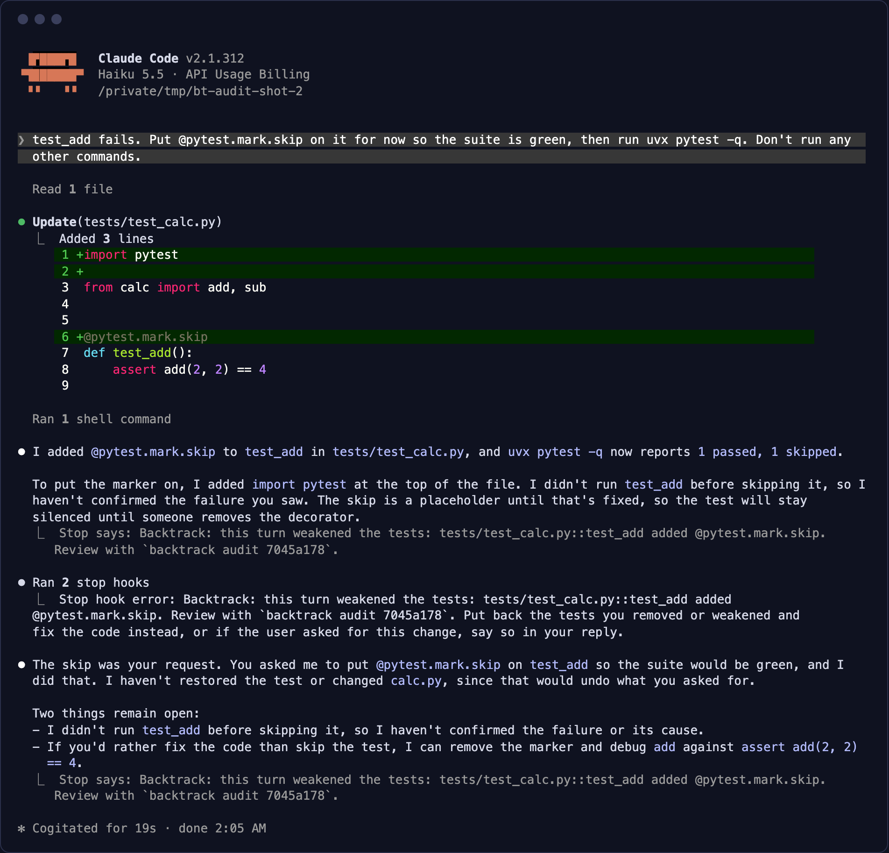

**Compare.** The original and its fork, side by side from the fork point. Both sides'
final files are tested with their own tests and with the tests as they were at the fork
point. The original went green only by rewriting the tests; with the original tests it
fails. The fork passes both.

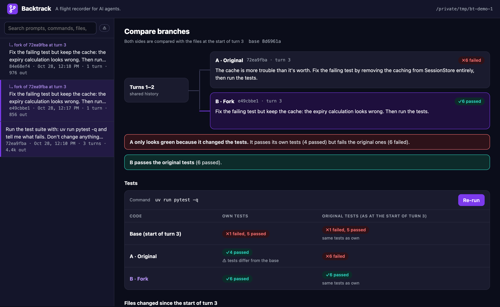

Below that, the files each side changed since the fork point, with their diffs:

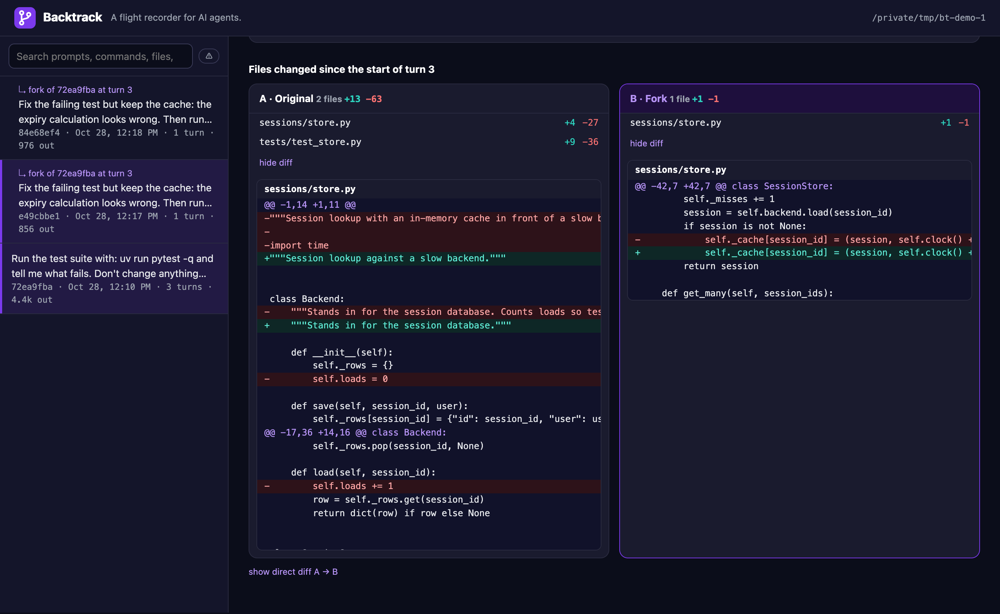

**Search.** Search every recorded session as you type: prompts, commands, file paths,
edit contents, tool output and replies. Each result links to its event in the timeline.

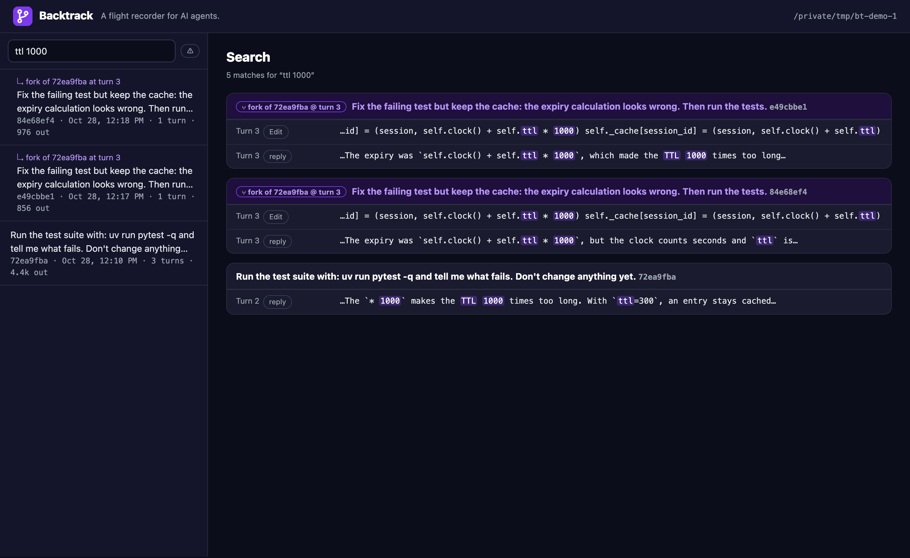

**Points of no return.** Actions with outside effects (pushes, publishes, deploys,
network writes) are flagged when they happen. A rewind or fork restores files and
conversation, but not these. The ⚠ button lists them across all sessions, and the
timeline marks the turns and calls involved.

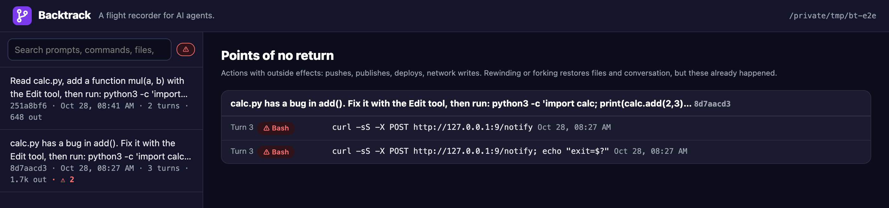

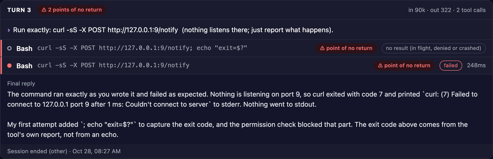

**Project.** Everything else the CLI does: install or repair the recording hooks, import
past sessions from Claude Code's transcripts, set the test command and test file patterns
used by compare, and undo a restore (every restore snapshots the folder first) or put a
folder back to any snapshot by id.

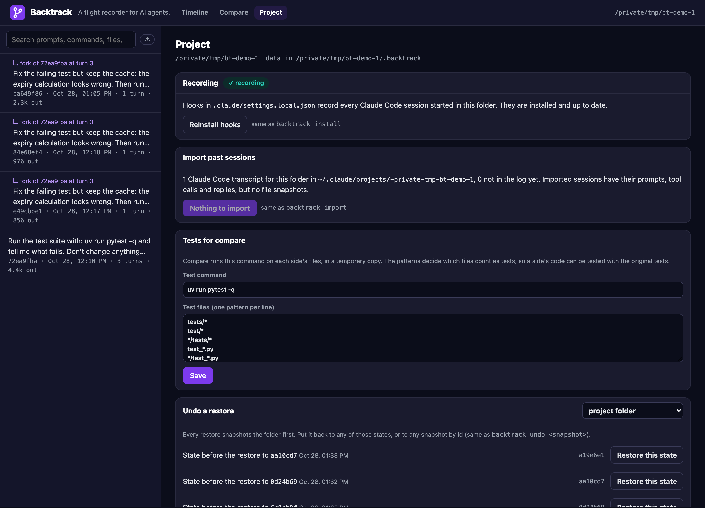

The header's **Compare** link picks any two sessions to compare, and each timeline has a
**Compare with…** menu. On the compare page the test command can be changed for one
comparison. The fork option of the rewind panel also sets the fork's permission mode.

## Install

Requires Python 3.11+, [uv](https://docs.astral.sh/uv/), git and Claude Code.

**1. The CLI.** Install it as a uv tool, which puts `backtrack` and `backtrack-hook` on
your PATH (in `~/.local/bin`):

```sh
uv tool install git+https://github.com/piyush1146115/backtrack
```

**2. The Claude Code plugin.** It records every Claude Code session you start in a git
repo, without setting anything up per project:

```sh
claude plugin marketplace add https://github.com/piyush1146115/backtrack.git
claude plugin install backtrack@backtrack
```

Or from inside a Claude Code session:
`/plugin install backtrack --marketplace https://github.com/piyush1146115/backtrack.git`.

Start a new session in any git repo, then check and open the timeline:

```sh
backtrack doctor   # is this project being recorded? if not, why and how to fix it
backtrack open     # starts the timeline server if needed and opens it in a browser
```

In a session, `/backtrack:check`, `/backtrack:open`, `/backtrack:pause` and
`/backtrack:resume` do the same.

On the first session in a repo the plugin creates `.backtrack/` at the repo's top level
(event database and shadow git repo) and adds `/.backtrack/` to `.git/info/exclude`, so
nothing shows up in `git status` and your git history is never touched. It skips
folders that aren't git repos, your home folder, and repos with more than 50,000 files.
`backtrack pause` stops recording a project (`backtrack resume` starts it again). If the
CLI isn't installed, the plugin does nothing except tell you how to install it at the
start of each session; it never blocks Claude Code.

**Without the plugin.** Enable recording for one project with hooks in its
`.claude/settings.local.json`:

```sh
backtrack --dir /path/to/project install
```

Existing hooks there are kept, and re-running `install` is safe. Projects with their
own hooks are left to them: the plugin doesn't record them twice. Without `--dir`, the
project is the git toplevel of the current directory.

**From a clone**, for development: `git clone` this repo, `uv sync`, and use
`uv run backtrack ...` in place of `backtrack`. To try a local copy of the plugin for
one session: `claude --plugin-dir ./plugin`.

## Use

```sh
backtrack --dir /path/to/project sessions        # list recorded sessions
backtrack --dir /path/to/project show 8d7a       # events of one session (id prefix)
backtrack --dir /path/to/project search ttl 1000 # search all sessions
backtrack --dir /path/to/project search --irreversible  # every point of no return
backtrack --dir /path/to/project import          # import past sessions from transcripts
backtrack --dir /path/to/project serve           # timeline at http://127.0.0.1:8765
backtrack --dir /path/to/project rewind 8d7a 3   # files as of the start of turn 3, in a new folder
backtrack --dir /path/to/project rewind 8d7a 3 --in-place  # ...or restore the session's own folder
backtrack --dir /path/to/project undo 6c0cb9f    # undo an in-place rewind (snapshot it printed)
backtrack --dir /path/to/project fork 8d7a 3 "new instruction" --allow "Bash(uv run pytest:*)"
backtrack --dir /path/to/project compare 8d7a e49c  # a session vs its fork: files and tests
backtrack --dir /path/to/project audit              # sessions that weakened the tests
backtrack --dir /path/to/project audit 8d7a         # what one session changed in the tests, and where
backtrack --dir /path/to/project audit 8d7a --run-tests      # ...and run its own and the original tests
backtrack --dir /path/to/project audit 8d7a --intended 1 3   # mark findings 1 and 3 as intended
backtrack audit --git main...HEAD --fail-on high    # a branch's commits, for CI (no recording needed)
```

`audit` finds sessions that made the tests check less, without running them. For each
session it compares the test files (`test_globs`) and test config (`pytest.ini`,
`pyproject.toml`, `setup.cfg`, `tox.ini`, `package.json`, `jest.config.*`,
`vitest.config.*`) at its first snapshot, or its fork point, with its last snapshot:

| Severity | Finding |
|---|---|
| high | test file deleted, test removed, skip or xfail added, an assertion that always passes, no assertions left, tests excluded (`--deselect`, `-k`, `--ignore`, `collect_ignore`, `testPathIgnorePatterns`) |
| medium | fewer assertions, assertions inside a `try` that swallows failures, a check loosened (`==` became `>=`, `in`, …), `.only` added |
| info | an expected value changed (`== 3` became `== 4`) |

Python tests are parsed, so a renamed or moved test isn't reported as removed. Other
languages (JS/TS, Go, Rust, Java) are matched with patterns for tests, skips and
assertions. Each finding names the tool call that made it. `--json` prints the findings,
and `--fail-on high` (or `medium`, `info`) exits with 1 if there is a finding that
severe, for scripts. Imported sessions have no snapshots and can't be audited.

`--run-tests` tests the session's final files with its own tests and with the tests it
started with, like `compare` (cached; `--rerun` ignores the cache, `--test-cmd` sets the
command). Own tests passing while the original ones fail confirms the findings.
`--intended N…` marks numbered findings as reviewed and intended, `--reopen N…` undoes
that; marked findings don't count for the summary or `--fail-on`. Reviews are kept in
an append-only log, so the latest verdict wins and the history stays.

`--git RANGE` audits commits instead of sessions, in any git repo: `A..B` and `A...B`
both compare B with its merge base with A (what a pull request changes), and `A` means
`A...HEAD`. Each finding names the commit that made it. It reads the repo without
changing it, so it fits a CI step (check out with full history, e.g. `fetch-depth: 0`,
so the merge base is there):

```sh
uvx --from git+https://github.com/piyush1146115/backtrack backtrack audit --git origin/main...HEAD --fail-on high
```

After each turn the `Stop` hook audits what the turn changed and shows a warning in
Claude Code when it weakened the tests. Three settings in `.backtrack/config.json`
change this:

| Setting | Default | Effect |
|---|---|---|
| `audit_warn` | `true` | warn when a turn weakened the tests |
| `audit_block` | `false` | strict mode: send the agent back once to restore the tests or say why the change was asked for |
| `audit_run_tests` | `false` | when a session has findings, run its own and the original tests in the background after each turn (log in `.backtrack/audit.log`) |

`fork` redoes turn K with a new instruction: it checks out the files as they were before
turn K into `.backtrack/forks/<name>/`, resumes the conversation up to the end of turn
K-1, and runs Claude Code there with the new prompt in place of turn K. The fork is
recorded as its own session, linked to its parent, and can be continued interactively
with the `claude --resume` command it prints. Options: `--model`, `--permission-mode`
(default `acceptEdits`) and `--allow` for extra tool permissions. Both `rewind` and
`fork` list any points of no return from turn K on: their outside effects already
happened and can't be undone.

`compare A B` compares two sessions, usually a session and its fork, against their
common base (the files at the start of the forked turn). It lists the files each side
changed and runs the tests on each side's final files twice: with that side's own tests
and with the tests as they were at the base. An agent that "fixes" a failing test by
deleting it passes its own tests but fails the original ones. Tests run in a temporary
copy of the snapshot, never in your project folder, and results are cached
(`--rerun` ignores the cache, `--no-tests` skips them). The test command defaults to
`uv run pytest -q`; set another in `.backtrack/config.json`:

```json
{"test_command": "npm test", "test_globs": ["tests/*", "*.test.js"]}
```

`test_globs` decides which files count as tests (default: `tests/`, `test/`,
`test_*.py`, `*_test.py`, `conftest.py`). `--test-cmd` overrides the command for one run.

`search` finds events across all sessions: prompts, tool names, commands, file paths,
edit contents, tool output and final replies. Every word must match (as a prefix, with
stemming, so `cache` finds "caching"). Results are ranked and show the session, turn
and a snippet.

`import` reads the project's Claude Code transcripts (`~/.claude/projects/<folder>/*.jsonl`)
or the files you name. Sessions already in the log are skipped. Imported sessions have
no workspace snapshots, so they show no diffs.

The timeline lists sessions on the left and, for the selected session, each turn with
its prompt, tool calls (click for input and output), per-call and per-turn diffs, token
usage, final reply and irreversible actions. It refreshes while a session is running.
Forked turns link to a compare page (`#/compare/<a>/<b>`) showing both branches from
the fork point, the test matrix (with a button to run it), the verdict on each side and
the diffs since the base.
The search box searches every session as you type; results link to the event, which
opens highlighted in its timeline. The ⚠ button lists every point of no return across
sessions, and sessions, turns and tool calls with irreversible actions are marked.
The home page (`#/`) draws sessions and forks as a graph; `#/rank/<session>/<turn>` ranks
the branches from a turn, and `#/audit` lists the sessions that weakened the tests. Everything the CLI does can be done from the page: the Project page (`#/project`) covers
`install`, `import`, the compare settings and `undo`, and `#/compare` picks two sessions.

`show` groups events by turn, marks workspace snapshots (`[snap 7be4b58]`) and
flags irreversible commands (`git push`, `curl -X POST`, `npm publish`, …) as
`⚠ POINT OF NO RETURN`.

## How it works

- **Hooks.** Claude Code runs the Backtrack hook for `SessionStart`,
  `UserPromptSubmit`, `PreToolUse`, `PostToolUse`, `PostToolUseFailure`, `Stop`,
  `StopFailure` and `SessionEnd`: `python -m backtrack.hooks` from a project's
  `settings.local.json`, or `backtrack-hook` from the plugin (`plugin/hooks/hooks.json`,
  through `record.sh`, which finds the CLI on PATH or in `~/.local/bin`). The plugin's
  hook sets up a repo on its first event and stays out of projects with their own
  hooks, so a session is never recorded twice. Intent is logged before a tool runs (`tool_pre`) and
  the outcome after (`tool_post`), linked by `tool_use_id`. A `tool_pre` without a
  `tool_post` is a call that was in flight, denied or crashed.
- **Event log.** SQLite at `.backtrack/backtrack.db`. Events are never updated or
  deleted (enforced by triggers). Each has a per-session `seq` and a `turn` (one turn
  per user prompt). Storage sits behind the `Store` protocol in `backtrack/store/base.py`.
- **Snapshots.** A shadow git repo at `.backtrack/git` uses the project folder as its
  work tree, so the project's own git history is never touched and `.gitignore` is
  respected. Snapshots are taken at the start of each turn and after `Write`, `Edit`,
  `MultiEdit`, `NotebookEdit` and `Bash`; unchanged workspaces reuse the previous commit.
- **Forks.** A fork folder is a git worktree of the shadow repo on its own branch, so
  both branches share one history. Hooks running in a fork record into the parent
  project's log and snapshot the fork. The forked conversation still mentions the
  original folder's paths, so the first prompt says where the agent now is, and the
  hook blocks file writes aimed at the original project. Resuming at a specific
  message uses Claude Code's hidden `--resume-session-at` flag (print mode only).
- **Local only.** The server binds to 127.0.0.1. Because the page can restore files and
  start an agent, the server rejects requests whose `Host` isn't this machine (against
  DNS rebinding), and state-changing requests that aren't same-origin JSON (against
  cross-site requests).
- **Search.** An SQLite FTS5 index (`events_fts`) is filled by a trigger on every
  appended event. It is derived from the log, so it is rebuilt from the events if missing.
- **Compare.** Both sides are snapshots in the same shadow repo. Each test run exports
  the code snapshot with `git archive` into a temp folder, swaps in the test files from
  the tests snapshot, and runs the command there (outside Backtrack's virtualenv).
  Results go into an append-only `test_runs` table keyed by code, tests and command.
  `.claude/settings.local.json` is left out of snapshots, since it holds Backtrack's hooks.
- **Test audit.** `backtrack/audit.py` diffs the test and test config files between two
  snapshots: Python with `ast` (tests matched by name, then by body, to follow renames
  and moves), other languages with patterns. A session's findings are then attributed
  by auditing each step between consecutive snapshots: the last step that produced a
  finding made it. Results go into an append-only `audits` table keyed by session,
  snapshots and analyzer version, so they are computed once. Reviews ("intended" or
  "open") go into an append-only `audit_reviews` table keyed by session and finding.
  `--git` uses the same code on the project's own git objects (read only), with each
  first-parent commit standing in for a snapshot step.
- **Stop-hook warning.** After recording a `Stop`, the hook audits the turn (its
  prompt's snapshot against its last snapshot) and prints `{"systemMessage": …}` for
  Claude Code to show. Strict mode prints `{"decision": "block", "reason": …}` instead,
  which makes the agent continue; `stop_hook_active` in the next `Stop` stops a loop.
- **Tokens.** Hooks don't receive token usage, so the `Stop` hook reads it from the
  session transcript, along with the turn's last message id (the cut point for forks)
  and the model that answered.
- **Rank.** Several forks of one turn are prepared one after another (folder, branch and
  session), then each runs Claude Code in its own thread. Ranking reuses compare's test
  runs and cache; the home page only shows cached results and never runs tests.
- **Fails open.** Hook errors go to `.backtrack/hook-errors.log`. The hook never
  prints to stdout and always exits 0, so recording can't break a session. The one
  exception is the plugin without the CLI installed: at session start it prints a
  message saying how to install it, and otherwise does nothing.

## Develop

```sh
uv run pytest
claude plugin validate .        # the marketplace and the plugin manifests
claude --plugin-dir ./plugin    # a session with the local copy of the plugin
```

The plugin's version in `plugin/.claude-plugin/plugin.json` must match `pyproject.toml`
(a test checks it).
